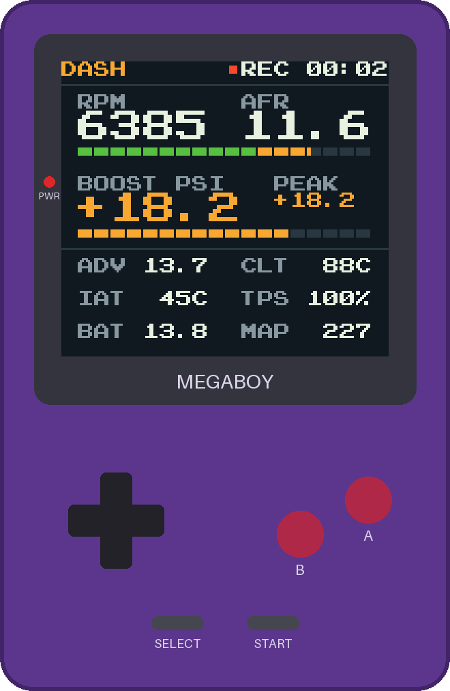

# megaboy

megaboy is my Game Boy Color dash and tuning tool for MegaSquirt. An RP2040 sits between the ECU and the Game Boy, reading engine data over serial and sending it through the link port. It works with MS1/Extra and MS2/Extra, and the GBC buttons let you start a log or change a table in the ECU.

<p align="center"></p>

The dash running in an emulator, waiting for the bridge.

## How it fits together

```
MS1/Extra or MS2/Extra DB9 (RS232) -> MAX3232 -> RP2040 bridge -> level shifter -> GBC link port
```

The bridge handles the ECU protocols, unit conversions and SD card. The GBC draws the screens and sends back commands when you change a setting or edit a table. The bridge supplies the link clock; the GBC uses external clock mode.

The code is split along those lines: [bridge/](bridge/) contains the RP2040 firmware, [gbc/](gbc/) the GBDK-2020 ROM, and [common/](common/) the shared protocols and tuning definitions. [nano/](nano/) is an earlier MS1-only test bridge.

## What is there now

There are dash, boost and track screens. The track page gives most of the screen to RPM, coolant temperature and intake temperature. You can record logs to SD in MegaLogViewer format, add an RTC so the files get proper dates, and edit fuel, spark, AFR, rev limit and boost tables.

The numbers in the [performance notes](docs/performance.md) come from an MS1/Extra on the bench, a Pico bridge and the ROM running in PyBoy. That includes the fixes for slow drawing, missed serial commands and an SD probe that could hold up the bridge for half a second. MS2 support uses the `MS2Extra comms332m2` layout in the included INI.

These are the main dash values:

| Value | Source | Notes |
|---|---|---|
| RPM | `rpm` | |
| Boost | `map - baro` | psi, negative is vacuum |
| Ignition advance | `advance` | deg, /10 |
| CLT | `coolant` | MS2 sends degF x10, convert to C |
| IAT | `mat` | MS2 sends degF x10, convert to C |

Offsets depend on the ECU firmware. Check its INI before using a different version.

## Building and connecting it

Start with the [hardware notes](docs/hardware.md) for parts, wiring and power. With GBDK-2020 installed at `~/opt/gbdk`, build the ROM with:

```sh
make -C gbc
```

Copy `gbc/build/megaboy.gbc` to the flash cart. You can override `GBDK_HOME` if GBDK is installed elsewhere. The Pico build is defined in [bridge/CMakeLists.txt](bridge/CMakeLists.txt); [CI](.github/workflows/ci.yml) has the full toolchain setup. Releases include both the ROM and Pico firmware.

Once connected, choose MS1 or MS2 under SETTINGS > ECU. The bridge remembers the choice and won't talk to the ECU until one is set. The [tuning guide](docs/tuning.md) explains the editor and what happens when you write, discard or burn a change.

For protocol work, see the [GBC link](docs/link-protocol.md), [MS1](docs/ms1-protocol.md) and [MS2](docs/ms2-protocol.md) references. The [Nano notes](docs/nano.md) cover the smaller test setup.

## Before editing a tune

Save a backup MSQ in TunerStudio first. Edits go to ECU RAM; burning them to flash is a separate confirmation. The bridge restricts writes to the supported tables and checks each table's range and maximum write step. The GBC splits larger changes into smaller writes and asks for a readback on the last step. A mismatch shows `VERIFY FAILED`.

An unexpected ECU signature blocks tuning. There is no RPM lockout: you can write and burn while the engine is running. Losing power during a burn can corrupt the page, so keep that in mind before confirming it. The limits and checks are described in the [tuning guide](docs/tuning.md).

## Tests

The host tests run without connected hardware and use UBSan by default:

```
make -C common test && make -C gbc test && make -C bridge/test test
```

For ASan and UBSan together, the Docker script runs them on Linux with the source mounted read-only and networking disabled:

```
tools/docker/test.sh
```

## CI and releases

Every push to main and every pull request runs the host tests with ASan and UBSan, checks Python syntax, and builds the GBC ROM, Pico firmware and Nano sketch.

To publish a release, tag a commit on main and push the tag:

```
git tag vX.Y.Z
git push origin vX.Y.Z
```

Replace `vX.Y.Z` with the next version. The release contains `megaboy.gbc`, `bridge.uf2` and `SHA256SUMS`.

The workflow pins actions and Git dependencies to commits, checks downloaded archives against SHA-256 hashes, and selects a fixed Arduino AVR core version. When updating an archive, change its URL and hash together.
